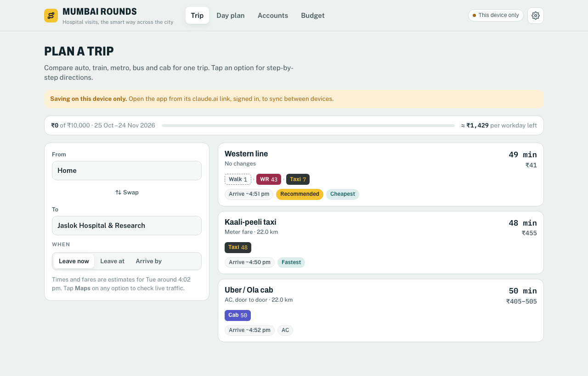
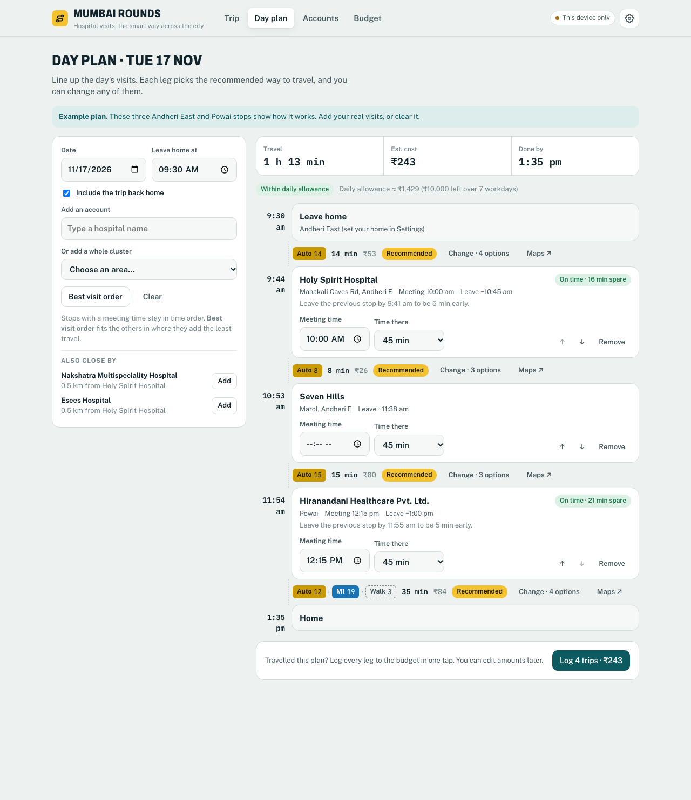
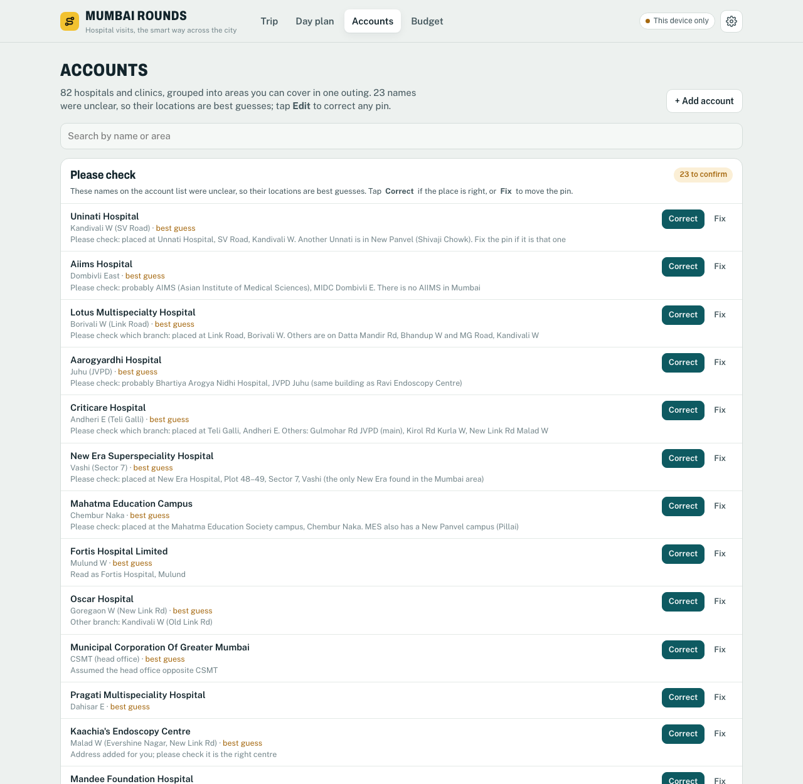
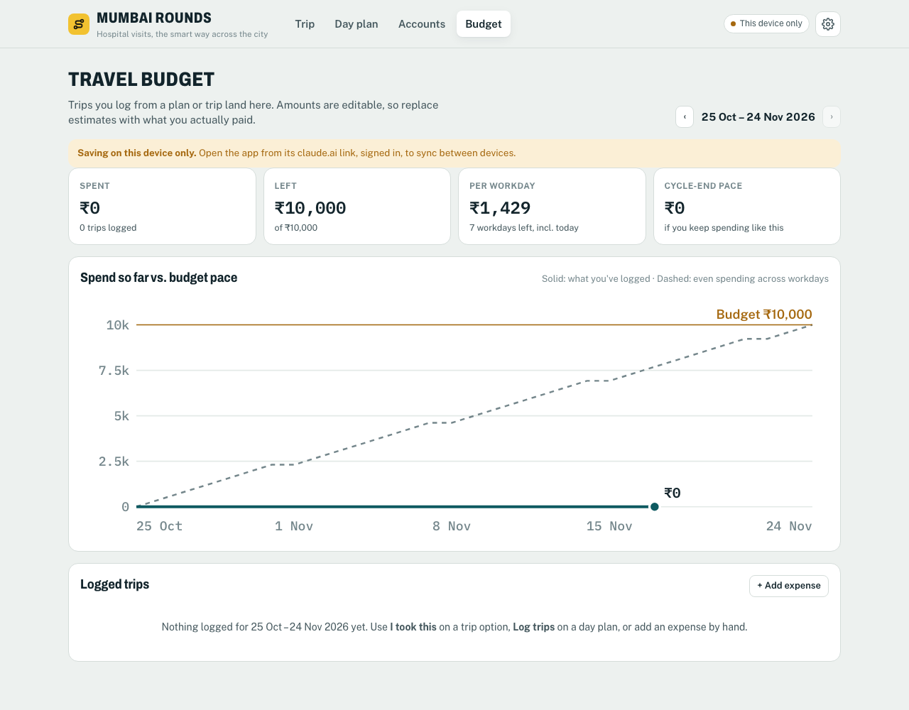
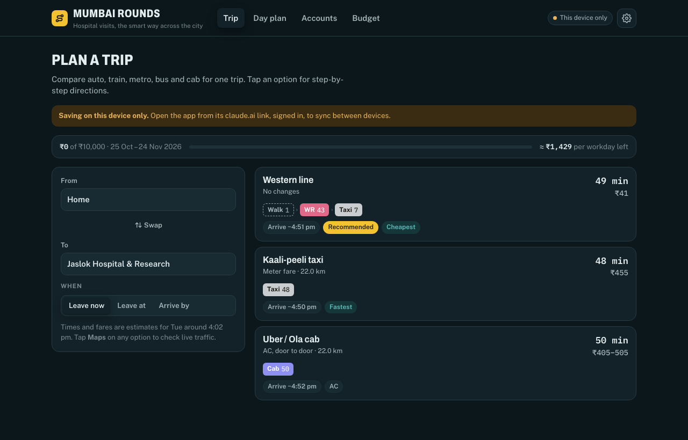

# Mumbai Rounds

**A transport planner for field visits across Mumbai: auto, local train, metro, bus, cab or walk, and which one gets you there on time without blowing the travel budget.**

Mumbai Rounds was built for a field business analyst who spends her days visiting hospitals and clinics from Andheri to Colaba, Navi Mumbai and Kalyan. For every trip it compares every sensible way to get there and recommends one. It plans multi-stop days around meeting times and tracks spending against a monthly travel allowance. It runs entirely in the browser with no API keys, works on phone and laptop, and syncs between them when published as a Claude artifact.



---

## Features

### 🚦 Trip: compare every way to get there
- Options for **walking, auto rickshaw, kaali-peeli taxi, Uber/Ola, BEST/NMMT bus and multi-leg train + metro routes**, each with time, fare and a step-by-step breakdown.
- **Recommended / Cheapest / Fastest** tags, based on whether you'd rather save money, save time or balance the two.
- **Leave now**, **Leave at** or **Arrive by**. Arrive-by tells you when to leave for each option.
- Mumbai-specific rules: no autos south of Bandra/Sion, rush-hour slowdowns, packed-train warnings, surge ranges for cabs.
- A **Maps ↗** button on every option to check live traffic in Google Maps.

### 🗓️ Day plan: several hospitals in one outing
- Add accounts one by one or a whole **area cluster** at once.
- Set a **meeting time** and **time on site** for each stop; the plan flags **On time / Tight / Late** and suggests a faster option when you're running late.
- **Best visit order** keeps timed stops in sequence and slots the rest in where they add the least travel.
- Change the travel mode for any leg. Totals show travel time, cost, finish time and how the day compares to the daily allowance.
- **Also close by** suggests other accounts within 1.6 km of the planned stops.
- Log the whole day to the budget in one tap.



### 🏥 Accounts: grouped by area
- 82 hospitals and clinics in 16 clusters (Parel medical hub, Juhu & Vile Parle, Vashi & Kopar Khairane, and so on), each with the typical time and cost from home.
- **Please check**: accounts whose names were ambiguous carry a best-guess pin and a note. One tap confirms it, or **Fix** moves it.
- **Needs a location**: set from the nearest station or by pasting a Google Maps pin.
- Add your own accounts. Full list: [docs/accounts.md](docs/accounts.md).



### 💰 Budget: a ₹10,000 cycle from the 25th
- The budget runs **from the 25th of one month to the 24th of the next**; the start day is configurable.
- Shows spent, left, **allowance per remaining workday**, and **cycle-end pace**, with a gentle warning when you're trending over.
- A pace chart of cumulative spend against even spending, and a breakdown by mode.
- Edit any logged amount to what you actually paid, or add expenses by hand.



### 🔄 Works on phone and laptop
- Responsive layout with a bottom tab bar on phones, and light and dark themes.
- **Synced** across devices through the Claude artifact database. Data saved offline can be uploaded in one tap, and a **backup code** moves data between devices without sync.

<p align="center"></p>

---

## Quick start

No install and no build step are needed to run it locally.

```bash
git clone https://github.com/advk2k4/mumbai-rounds.git
cd mumbai-rounds
python3 scripts/serve.py        # → http://localhost:8765
```

Then open **Settings** and set your home location.

To produce a single self-contained file for hosting:

```bash
python3 scripts/build.py                # dist/mumbai-rounds.html (Claude artifact)
python3 scripts/build.py --standalone   # dist/mumbai-rounds.standalone.html (any host)
```

See **[docs/deploying.md](docs/deploying.md)** for publishing as a Claude artifact with cross-device sync.

---

## Project structure

```
mumbai-rounds/
├── README.md
├── LICENSE
├── src/                         ← the app (open src/index.html via scripts/serve.py)
│   ├── index.html               page shell + script load order
│   ├── styles/app.css           design tokens (light/dark), layout, components
│   └── js/
│       ├── core/                helpers: formatting, dates, distance
│       ├── data/                accounts + area clusters, rail & metro network
│       ├── engine/              fares, road speeds, routing & scoring
│       ├── state/               app state, storage & sync, places, budget cycle
│       └── ui/                  one file per tab + shared components + app shell
├── scripts/
│   ├── serve.py                 local dev server
│   ├── build.py                 bundle src/ into one HTML file → dist/
│   └── generate-accounts-doc.js regenerate docs/accounts.md from the data
└── docs/
    ├── how-estimates-work.md    fare tables, speed model, routing, scoring
    ├── architecture.md          code layout, rendering, storage & sync design
    ├── deploying.md             Claude artifact / static hosting / local dev
    ├── accounts.md              every account, its area and pin status
    └── screenshots/
```

---

## How it works

**No maps API.** Everything is estimated in the browser from a compact model of the city:

1. **Road trips** use straight-line distance × 1.3, at speeds that drop to ~17 km/h in rush hour. Fares follow the current meter rates for autos and taxis and approximate Uber/Ola pricing.
2. **Transit** runs Dijkstra over a 179-station graph of the Western, Central, Harbour and Trans-Harbour locals and Metro 1, 2A, 7 and 3 (Aqua line). Stations near each line are reached on foot or by auto, and changes between nearby stations are generated automatically.
3. **Scoring** combines minutes, rupees (weighted by your priority), walking, changes and rush-hour crowding into one score. The lowest score is **Recommended**.

The full details, including every fare slab, are in **[docs/how-estimates-work.md](docs/how-estimates-work.md)**.

**Tech:** vanilla JavaScript (no framework, no dependencies), CSS custom properties for theming, Google Fonts (Archivo, Public Sans, IBM Plex Mono), and the Claude artifact runtime (`db` capability) for optional sync.

---

## Customising

| To change… | Edit |
|---|---|
| The account list | [`src/js/data/accounts.js`](src/js/data/accounts.js), then `node scripts/generate-accounts-doc.js` |
| Area clusters | `ZONES` in the same file |
| Fares and speeds | [`src/js/engine/fares.js`](src/js/engine/fares.js) |
| Stations and lines | [`src/js/data/network.js`](src/js/data/network.js) |
| Default budget, cycle day, home | `DEF_PREFS` in [`src/js/state/storage.js`](src/js/state/storage.js), or in the app's Settings |

---

## Limitations

- These are estimates, not live data: there's no real-time traffic, train timetable or disruption feed. Use the Maps button before leaving.
- Bus route numbers aren't modelled.
- Pins are accurate to a few hundred metres, and 23 account names are best guesses waiting for confirmation.
- Fares reflect 2025–26 rates and need updating when they change.

## License

[MIT](LICENSE) © 2026 Aadvik Mishra
